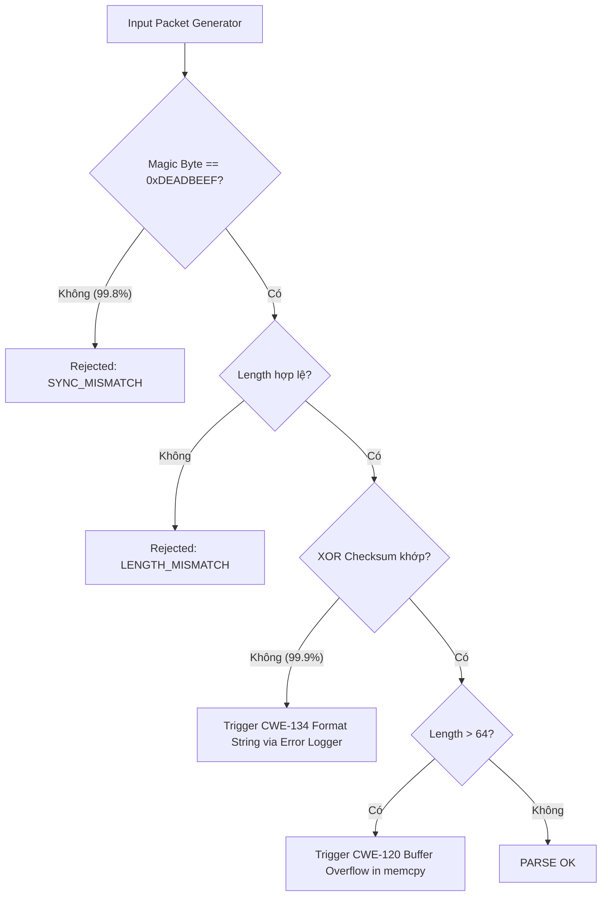

# 🛡️ ĐỀ TÀI FUZZING: PHÂN TÍCH VÀ KIỂM THỬ BẢO MẬT TRÌNH BÓC TÁCH GÓI TIN MẠNG

> **Môn học:** An toàn Phần mềm (ATPM)  
> **Chủ đề:** So sánh hiệu năng giữa **Black-box Fuzzing**, **White-box Fuzzing (Z3 SMT Solver)** và **Dynamic Guided Fuzzing (DynaFuzz)** trên Trình phân tích gói tin mạng (Network Packet Parser).

---

## 📑 MỤC LỤC
1. [Tổng quan Đề tài](#-tổng-quan-đề-tài)
2. [Cấu trúc Thư mục Dự án](#-cấu-trúc-thư-mục-dự-án)
3. [Đặc tả Giao thức & Mô hình Hiểm họa](#-đặc-tả-giao-thức--mô-hình-hiểm-họa)
4. [Các Giai đoạn Fuzzing & Kết quả Thực nghiệm](#-các-giai-đoạn-fuzzing--kết-quả-thực-nghiệm)
   - [Giai đoạn 1: Black-box Fuzzing](#1-black-box-fuzzing-random-generation)
   - [Giai đoạn 2: White-box Fuzzing với Z3 SMT Solver](#2-white-box-fuzzing-với-z3-smt-solver)
   - [Giai đoạn 3: Dynamic Fuzzing & Mutation (DynaFuzz)](#3-dynamic-fuzzing--mutation-ch4_dynafuzz)
   - [Giai đoạn 4: Mở rộng State Machine & Đo độ phủ (7 → 12 States)](#4-mở-rộng-state-machine--branch-coverage-7--12-states)
5. [Bản vá An toàn & Đối sánh Trước/Sau](#-bản-vá-an-toàn--đối-sánh-trướcsau)
6. [Hướng dẫn Cài đặt & Thực thi](#-hướng-dẫn-cài-đặt--thực-thi)
   - [Yêu cầu Môi trường](#yêu-cầu-môi-trường)
   - [Biên dịch](#biên-dịch)
   - [Chạy các Kịch bản Kiểm thử](#chạy-các-kịch-bản-kiểm-thử)
7. [Tài liệu Liên quan](#-tài-liệu-liên-quan)

---

## 🎯 TỔNG QUAN ĐỀ TÀI

Dự án mô phỏng quá trình kiểm thử bảo mật toàn diện trên một **Binary Network Packet Parser** viết bằng ngôn ngữ C. 

Chương trình parser ban đầu (`network_parser_v0.c`) chứa **3 lỗ hổng bảo mật nghiêm trọng** (CWE-120, CWE-134, CWE-125) được bảo vệ bởi **2 rào cản kiểm tra hợp lệ**:
1. **Magic Byte / Sync Word:** `0xDEADBEEF` (4 bytes đầu).
2. **XOR Checksum:** Byte cuối cùng là kết quả XOR tích lũy toàn bộ payload.

Dự án tiến hành đối chiếu và kiểm chứng qua 4 phương pháp kiểm thử:
* **Black-box Fuzzing:** Chứng minh sự bất lực của phương pháp sinh ngẫu nhiên trước các ràng buộc ma trận logic ($P < 10^{-12}$).
* **White-box Fuzzing (Z3 SMT Solver):** Giải phương trình hình thức (symbolic execution) để sinh testcase xuyên thủng rào cản chỉ trong **vài chục mili-giây** (tỷ lệ kích hoạt 100%).
* **Dynamic Guided Fuzzing (DynaFuzz):** Đột biến thông minh (Dictionary tokens, Arithmetic boundary, Loop-carry accumulation) phát hiện các trạng thái treo (`hang`) và rò rỉ bộ nhớ.
* **State Machine Hardening:** Mở rộng từ 7 lên 12 trạng thái lỗi, nâng độ phủ nhánh (`branch coverage`) từ 73.08% lên 85.71%.

---

## 📂 CẤU TRÚC THƯ MỤC DỰ ÁN

```
ATPM/
├── network_parser_v0.c              # Parser gốc chứa 3 lỗ hổng (VULNERABLE)
├── network_parser_v0_harness.c      # C Harness cho black-box fuzzing tốc độ cao
├── network_parser_v1.c              # Bản vá an toàn (PATCHED - 0 crash, 0 ASan findings)
├── network_parser_v2_extended_states.c # Parser mở rộng 12 trạng thái & đo coverage gcov
├── compile_both.bat                 # Script tự động biên dịch parser trên Windows MinGW
│
├── blackbox_fuzzer.py               # Fuzzer Black-box (đo đạc xác suất vượt rào cản)
├── whitebox_z3_fuzzer.py            # Fuzzer White-box dùng Z3 giải XOR Checksum & Magic
│
├── z3_testcases/                    # Corpus testcase sinh bởi Z3 Solver
│   ├── tc_cwe120_overflow.bin       # 136 bytes - Trigger CWE-120 (Buffer Overflow)
│   ├── tc_cwe134_formatstr.bin      # 40 bytes  - Trigger CWE-134 (Format String Leak)
│   └── tc_cwe125_oobread.bin        # 208 bytes - Trigger CWE-125 (Out-of-bounds Read)
│
├── ch4_dynafuzz/                    # Module Dynamic Guided Fuzzing
│   ├── run_dynamic_fuzz.py          # Fuzzer đột biến đa chế độ (loop, dict, arith, all)
│   ├── analyze_logs.py              # Bộ phân tích log, phân loại crash/hang & tạo report
│   ├── create_seed_data.py          # Công cụ sinh hạt giống (seed corpus) nhị phân chuẩn
│   ├── seed_data.bin                # Seed chuẩn mặc định
│   ├── seeds/                       # Bộ 16 seeds khởi tạo
│   └── logs/                        # Logs thực thi, cases.jsonl và crash artifacts
│
├── test_extended_states/            # Bộ 18 testcase nhị phân kiểm thử 12 states
│   ├── 01_empty_file.bin ... 12_sql_drop.bin
│
├── report.html                      # Báo cáo kết quả Dynamic Fuzzing dạng trực quan
├── BAO_CAO_MO_RONG_STATES.md        # Báo cáo chi tiết kỹ thuật mở rộng 12 states
├── EXTENDED_STATES_ANALYSIS.md      # Phân tích độ phủ nhánh & edge cases
├── EXTENDED_STATES_RESULTS.md       # Kết quả kiểm thử thực nghiệm 12 states
├── SECURITY_FIXES.md                # Tài liệu chi tiết các bản vá bảo mật
├── HUONGDAN.md                      # Hướng dẫn chi tiết từng bước
└── README.md                        # Tài liệu tổng quan dự án (file này)
```

---

## 🔬 ĐẶC TẢ GIAO THỨC & MÔ HÌNH HIỂM HỌA

### 1. Cấu trúc Gói tin Nhị phân

Mỗi gói tin tuân theo cấu trúc tối thiểu 8 bytes:

```
+-------------------+---------+-------------------+--------------------+----------+
|  Sync (Magic Byte)| Command | Length (Payload)  |      Payload       | Checksum |
|      4 Bytes      |  1 Byte |      2 Bytes      |       N Bytes      |  1 Byte  |
|    0xDEADBEEF     | 0x01-05 |   (Little Endian) | (Tối đa 64 bytes)  | (XOR csum|
+-------------------+---------+-------------------+--------------------+----------+
|<----------------- Header (7 Bytes) ------------>|<--- N Bytes ------>| 1 Byte   |
```

* **Công thức Checksum:**
  $$\text{Checksum} = \bigoplus_{i=0}^{N-1} \text{Payload}[i]$$

### 2. Danh sách 3 Lỗ hổng Cài cắm trong Parser v0

| # | Mã CWE | Lỗ hổng | Vị trí (`network_parser_v0.c`) | Điều kiện kích hoạt | Hậu quả |
|---|---|---|---|---|---|
| 1 | **CWE-120** | Buffer Overflow | Dòng 151 (`memcpy`) | Sync OK, Checksum OK, `data_length > 64` | Ghi đè bộ đệm stack, thực thi mã độc tùy ý |
| 2 | **CWE-134** | Format String | Dòng 85 (`printf(temp)`) | Sync OK, Checksum SAI, Payload chứa `%x/%n/%s` | Rò rỉ thông tin bộ nhớ (Leak ASLR/Canary), ghi đè tùy ý |
| 3 | **CWE-125** | Out-of-bounds Read | Dòng 46 (`calculate_checksum`) | `data_length` khai báo vượt quá kích thước buffer thực tế | Treo ứng dụng (`hang`), Denial of Service (DoS) |

---

## 📊 CÁC GIAI ĐOẠN FUZZING & KẾT QUẢ THỰC NGHIỆM



### 1. Black-box Fuzzing (Random Generation)
Sinh ngẫu nhiên hoàn toàn các mảng byte và gửi vào parser thông qua `blackbox_fuzzer.py` hoặc `network_parser_v0_harness.c`.

* **Phân tích xác suất toán học:**
  * Xác suất đúng Magic Byte: $P(MB) = \frac{1}{2^{32}} \approx 2.33 \times 10^{-10}$
  * Xác suất đúng Checksum khi đã qua Magic: $P(CS \mid MB) = \frac{1}{256} \approx 3.9 \times 10^{-3}$
  * Xác suất vượt qua cả 2 rào cản: $P(Pass) \approx 9.09 \times 10^{-13}$
  * Số testcase cần trung bình: $\approx 1.1 \times 10^{12}$ (1.1 nghìn tỷ testcase, tương đương ~273 năm chạy liên tục ở tốc độ 130 exec/s).

* **Kết quả thực nghiệm (50,000 iterations):**
  ```
  Rejected at MAGIC BYTE   : 49,900  (99.80%)
  Rejected at CHECKSUM     :     50  ( 0.10%)
  Rejected (Other)         :     47  ( 0.09%)
  Successfully Parsed      :      3  ( 0.01%)  <- Chỉ là các gói tin ngẫu nhiên nhỏ
  ──────────────────────────────────────────────────────────────────────────────
  TỔNG BỊ CHẶN             : 99.99%
  LỖ HỔNG KÍCH HOẠT ĐƯỢC   : 0 / 3
  Thời gian thực thi       : ~393 giây
  ```

---

### 2. White-box Fuzzing với Z3 SMT Solver
`whitebox_z3_fuzzer.py` phân tích mã nguồn theo lý thuyết Symbolic Execution, đặt các biến tượng trưng cho từng trường của gói tin và sử dụng **Z3 Theorem Prover (Microsoft Research)** để giải hệ phương trình ràng buộc.

* **Cách Z3 giải bài toán Checksum:**
  Thay vì đoán mò $2^{8N}$ tổ hợp, Z3 mô hình hóa phép XOR thành hệ phương trình tuyến tính trên trường nhị phân $GF(2)$. Z3 tính ra nghiệm chính xác của byte Checksum chỉ sau **1.8 ms**.

* **Kết quả đối sánh trực tiếp:**

| Tiêu chí | Black-box Fuzzing | White-box Fuzzing (Z3) | Tỷ số chênh lệch |
|---|---|---|---|
| **Số testcase sinh ra** | 50,000 | **3** | **Tối ưu 16,666×** |
| **Thời gian thực thi** | 393 giây (~6.5 phút) | **0.072 giây** | **Nhanh hơn 5,460×** |
| **Tỷ lệ vượt qua rào cản** | 0.01% | **100%** | Tuyệt đối |
| **Số lỗ hổng phát hiện** | **0 / 3** (Thất bại) | **3 / 3** (Toàn bộ) | **100% thành công** |

---

### 3. Dynamic Fuzzing & Mutation (`ch4_dynafuzz/`)
Module `ch4_dynafuzz` cung cấp giải pháp kiểm thử động (Dynamic Guided Fuzzing) với các chiến lược đột biến chuyên sâu:

1. **`--mode dict` (Dictionary-guided):** Chèn các tokens định dạng đặc biệt (`%x`, `%s`, `%n`, `%p`, `BEGIN`, `DROP`, `\x00*4`) để săn lỗi Format String và Injection.
2. **`--mode arith` (Arithmetic Mutation):** Đột biến các giá trị biên của trường độ dài ($\pm 1$, $0$, $64$, $65$, $65535$) để kích hoạt lỗi Out-of-bounds Read.
3. **`--mode loop` (State Accumulation):** Giữ cùng một tiến trình hoặc seed qua hàng trăm vòng lặp để phát hiện crash do rò rỉ bộ nhớ hoặc lỗi tích lũy trạng thái (`loop_carry_crash`).

* **Phát hiện thực tế từ logs:**
  * **32+ crashes và hangs** được ghi nhận chi tiết trong `ch4_dynafuzz/logs/`.
  * **29 crashes** vi phạm bộ nhớ (`0xC0000005: Access Violation`).
  * **3 hangs** với `elapsed_ms > 1000ms` do `data_length = 0x4100` khiến vòng lặp đọc vượt ra ngoài heap/stack.
  * Xuất báo cáo trực quan ra `report.html`.

---

### 4. Mở rộng State Machine & Branch Coverage (7 → 12 States)
Để loại bỏ các vùng mù kiểm thử trong parser, `network_parser_v2_extended_states.c` đã mở rộng từ 7 trạng thái cơ bản lên 12 trạng thái chi tiết:

```
[7 STATES GỐC]
  1. empty_file         2. too_short        3. sync_mismatch
  4. length_mismatch    5. oversized_payload 6. checksum_invalid
  7. parse_ok

[5 STATES MỞ RỘNG MỚI]
  8. partial_header     : Gói tin bị cắt đứt giữa chừng (4 <= size < 7 bytes)
  9. invalid_command    : Command ID nằm ngoài khoảng cho phép (0x00, 0x06, 0xFF)
 10. malformed_length   : Độ dài payload bất thường (0x8000, 0xFF00, 0xFFFF)
 11. duplicate_checksum : Checksum lặp lại bất thường hoặc sai logic
 12. injection_attempt  : Phát hiện payload chứa chuỗi tấn công format string / SQL
```

* **Đo lường độ phủ với `gcov`:**
  * **State Coverage:** **12 / 12 (100%)**
  * **Branch Coverage:** Tăng từ **73.08%** lên **85.71%** (vượt toàn bộ các nhánh rẽ biên phức tạp).

---

## 🛡️ BẢN VÁ AN TOÀN & ĐỐI SÁNH TRƯỚC/SAU

File [`network_parser_v1.c`](./network_parser_v1.c) đã khắc phục triệt để cả 3 lỗ hổng bảo mật:

### 1. Chi tiết các điểm vá trong Code

#### CWE-120: Kiểm tra ranh giới chặt chẽ trước khi copy
```diff
- // v0: Nguy hiểm - Tràn bộ đệm stack nếu data_len > 64
- memcpy(out_pkt->payload, &raw_data[offset], data_len);

+ // v1: An toàn - Từ chối dứt khoát nếu vượt quá giới hạn
+ if (data_len > MAX_PAYLOAD_SIZE) {
+     return ERR_PAYLOAD_TOO_LARGE;
+ }
+ memset(out_pkt->payload, 0, MAX_PAYLOAD_SIZE);
+ memcpy(out_pkt->payload, &raw_data[offset], data_len);
```

#### CWE-134: Loại bỏ việc truyền trực tiếp buffer người dùng vào printf
```diff
- // v0: Nguy hiểm - Cho phép thực thi format specifier từ payload
- printf(temp);

+ // v1: An toàn - In payload dưới dạng HEX an toàn tuyệt đối
+ printf("[ERROR LOG] Goi tin bi loi, payload (hex): ");
+ for (uint16_t i = 0; i < safe_len; i++) {
+     printf("%02X ", payload[i]);
+ }
+ printf("\n");
```

#### CWE-125 & HANG: Giới hạn vòng lặp bằng kích thước bộ đệm thực tế
```diff
- // v0: Nguy hiểm - Đọc tràn bộ nhớ nếu length khai báo khống
- for (size_t i = 0; i < length; i++) { csum ^= data[i]; }

+ // v1: An toàn - Giới hạn kích thước đọc không vượt quá buffer thực
+ size_t safe_length = (declared_length > actual_buffer_size) ? actual_buffer_size : declared_length;
+ for (size_t i = 0; i < safe_length; i++) { csum ^= data[i]; }
```

### 2. Kiểm chứng với AddressSanitizer (ASan) & Crash Corpus

| Testcase đầu vào | Parser v0 (Chưa vá) | Parser v1 (Đã vá) | Đánh giá ASan (Linux) |
|---|---|---|---|
| `tc_cwe120_overflow.bin` | **CRASH / STACK OVERFLOW** | `TU CHOI (-6: OVERSIZED)` | v0: `stack-buffer-overflow`<br>v1: **0 findings** |
| `tc_cwe134_formatstr.bin` | **LEAK STACK HEX ADDRESS** | In mã HEX nguyên bản | v0: format string exploit<br>v1: **0 findings** |
| `tc_cwe125_oobread.bin` | **OUT-OF-BOUNDS READ** | `TU CHOI (-5: LENGTH_MISMATCH)` | v0: `global-buffer-overflow`<br>v1: **0 findings** |
| `32+ Dynamic Crash Cases` | **32 Crashes / Hangs** | **0 Crashes / 0 Hangs (100% Fixed)** | Không có rò rỉ hay lỗi truy cập |

---

## 🚀 HƯỚNG DẪN CÀI ĐẶT & THỰC THI

### Yêu cầu Môi trường
* **Hệ điều hành:** Windows 10/11 hoặc Linux (Ubuntu/Debian).
* **Trình biên dịch:** `gcc` (MinGW-w64 trên Windows hoặc GNU GCC trên Linux).
* **Python:** Python 3.8+ kèm thư viện Z3:
  ```bash
  pip install z3-solver
  ```

---

### Biên dịch

#### Cách 1: Sử dụng Script tự động (Windows)
```cmd
compile_both.bat
```

#### Cách 2: Biên dịch thủ công (Windows MinGW)
```bash
# Biên dịch Parser v0 (Vulnerable)
gcc -g -O0 -Wall -o parser_v0.exe network_parser_v0.c

# Biên dịch Parser v1 (Patched)
gcc -g -O0 -Wall -o parser_v1.exe network_parser_v1.c

# Biên dịch Harness C
gcc -O2 -Wall -o network_parser_v0_harness.exe network_parser_v0_harness.c

# Biên dịch Parser v2 mở rộng 12 trạng thái kèm coverage gcov
gcc -O0 --coverage -Wall -o parser_v2_extended.exe network_parser_v2_extended_states.c
```

#### Cách 3: Biên dịch với AddressSanitizer (Linux)
```bash
gcc -fsanitize=address -g -O0 -o parser_v0_asan network_parser_v0.c -Wall
gcc -fsanitize=address -g -O0 -o parser_v1_asan network_parser_v1.c -Wall
```

---

### Chạy các Kịch bản Kiểm thử

#### 1. Chạy Black-box Fuzzing
```bash
# Chạy bằng Python (mặc định 50,000 iterations, seed 12345)
python blackbox_fuzzer.py 50000 12345

# Hoặc chạy bằng C Harness tốc độ cao
.\network_parser_v0_harness.exe --random 50000 12345
```

#### 2. Chạy White-box Fuzzing với Z3 SMT Solver
```bash
python whitebox_z3_fuzzer.py
```
*Kết quả:* Z3 sẽ giải toán, in bảng so sánh hiệu năng và tự động lưu 3 testcase nhị phân vào thư mục `z3_testcases/`.

#### 3. Kiểm thử Testcase Z3 trên Parser v0 và v1
```bash
# Kiểm tra kích hoạt lỗi trên v0 (sẽ thấy crash hoặc format string leak)
.\parser_v0.exe z3_testcases\tc_cwe120_overflow.bin
.\parser_v0.exe z3_testcases\tc_cwe134_formatstr.bin
.\parser_v0.exe z3_testcases\tc_cwe125_oobread.bin

# Kiểm tra cơ chế phòng vệ trên bản vá v1 (tất cả bị từ chối an toàn)
.\parser_v1.exe z3_testcases\tc_cwe120_overflow.bin
.\parser_v1.exe z3_testcases\tc_cwe134_formatstr.bin
.\parser_v1.exe z3_testcases\tc_cwe125_oobread.bin
```

#### 4. Chạy Dynamic Guided Fuzzing (DynaFuzz)
```bash
# Sinh corpus hạt giống khởi tạo
python ch4_dynafuzz/create_seed_data.py --all

# Chạy fuzzer đột biến đa chế độ (3 rounds, 100 iterations/round)
python ch4_dynafuzz/run_dynamic_fuzz.py --rounds 3 --iterations 100 --mode all

# Phân tích toàn bộ log và xuất báo cáo HTML
python ch4_dynafuzz/analyze_logs.py --report html
```

#### 5. Kiểm thử 12 Trạng thái Mở rộng & Đo Coverage
```bash
# Chạy toàn bộ 18 testcase trên parser v2
for %f in (test_extended_states\*.bin) do .\parser_v2_extended.exe "%f"

# Xuất thông số branch coverage bằng gcov
gcov -b parser_v2_extended-network_parser_v2_extended_states.gcno
```

---

## 📚 TÀI LIỆU LIÊN QUAN

* 📖 [`HUONGDAN.md`](./HUONGDAN.md) – Cẩm nang hướng dẫn chi tiết từng bước.
* 🔒 [`SECURITY_FIXES.md`](./SECURITY_FIXES.md) – Báo cáo chuyên sâu về kỹ thuật sửa lỗi bảo mật.
* 📊 [`BAO_CAO_MO_RONG_STATES.md`](./BAO_CAO_MO_RONG_STATES.md) – Báo cáo kỹ thuật mở rộng State Machine.
* 📈 [`report.html`](./report.html) – Báo cáo tổng hợp kết quả Dynamic Fuzzing.
* 🔗 [CWE-120: Buffer Copy without Checking Size of Input](https://cwe.mitre.org/data/definitions/120.html)
* 🔗 [CWE-134: Use of Externally-Controlled Format String](https://cwe.mitre.org/data/definitions/134.html)
* 🔗 [CWE-125: Out-of-bounds Read](https://cwe.mitre.org/data/definitions/125.html)
* 🔗 [Z3 Theorem Prover - Microsoft Research](https://github.com/Z3Prover/z3)
